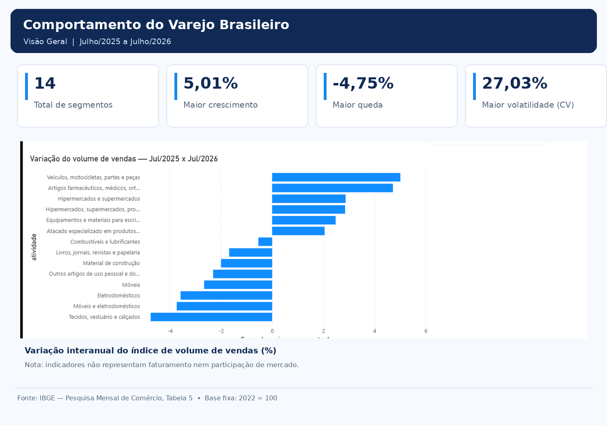
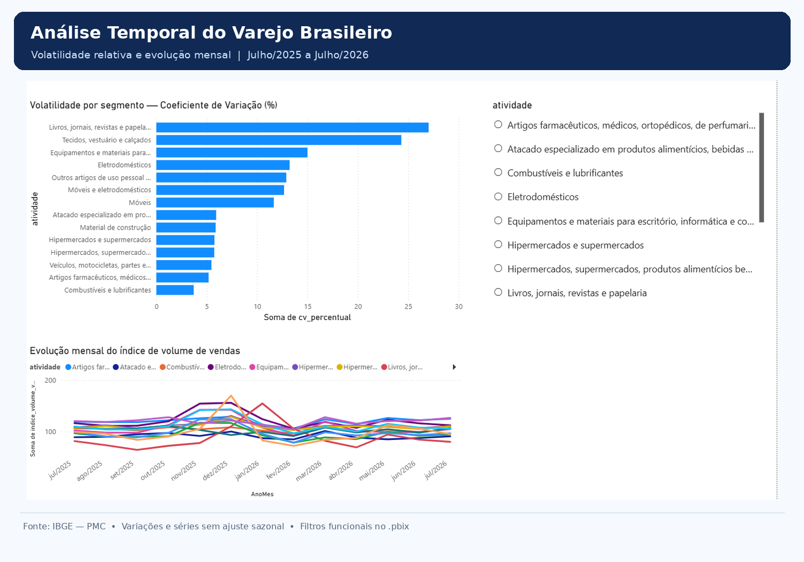

# Análise do comportamento do varejo brasileiro | Jul/2025–Jul/2026

## Visão geral
Projeto de análise exploratória e visualização de dados da Pesquisa Mensal de Comércio (PMC), do IBGE, com foco em comparar o desempenho de segmentos do varejo no intervalo de 13 meses (julho de 2025 a julho de 2026).

**Pergunta de negócio:** quais segmentos apresentaram maior crescimento ou retração interanual e quais tiveram maiores oscilações mensais no período?

## Fonte e escopo
- Fonte primária: **IBGE — Pesquisa Mensal de Comércio (PMC), Tabela 5, julho de 2026**.
- Indicador: **índice de base fixa do volume de vendas (2022 = 100)**, sem ajuste sazonal.
- Cobertura: julho de 2025 a julho de 2026, com observações mensais.
- Base tratada: 208 registros, correspondentes a 16 séries (14 atividades e subcategorias + 2 indicadores agregados) × 13 meses.
- As categorias incluem subcategorias e agregações hierárquicas, por isso **não devem ser somadas para representar um total de vendas**.

## Ferramentas e etapas
1. **Python / Pandas:** carregamento, inspeção e preparação da tabela original para o formato longo; checagem de tipos e campos.
2. **Python / Matplotlib:** exploração das séries temporais, comparação jul/2025 × jul/2026, taxas de variação mensal, desvio padrão amostral, coeficiente de variação e média móvel de três meses.
3. **MySQL / Workbench:** importação dos dados tratados, consultas com agregações, `JOIN` e `LAG()`, e construção de quatro Views analíticas (`vw_atividades`, `vw_variacao_anual`, `vw_volatilidade`, `vw_variacao_mensal`).
4. **Power BI:** importação de Views, tabelas dimensão de atividade e calendário, relacionamentos, indicadores e visuais exploratórios.

## Principais resultados
| Indicador | Resultado |
|---|---:|
| Maior variação interanual positiva (jul/25 × jul/26) | Veículos, motocicletas, partes e peças: **+5,01%** |
| Segunda maior variação interanual positiva | Artigos farmacêuticos e relacionados: **+4,72%** |
| Maior variação interanual negativa | Tecidos, vestuário e calçados: **−4,75%** |
| Maior coeficiente de variação no período | Livros, jornais, revistas e papelaria: **27,03%** |
| Maior aumento mensal observado (índice sem ajuste sazonal) | Vestuário, dez/2025: **+61,57%** |
| Maior queda mensal observada (índice sem ajuste sazonal) | Vestuário, jan/2026: **−51,17%** |

## Como interpretar
Há diferenças expressivas entre a variação interanual e a oscilação mensal das atividades. Os picos de fim de ano e as quedas em meses posteriores são compatíveis com efeitos de calendário, mas não permitem atribuição causal a promoções, ao Natal ou a um canal de venda específico.

## Limitações
- **A PMC não distingue diretamente vendas em lojas físicas e e-commerce** nesta tabela. Portanto, este projeto não estima migração entre canais nem mede comportamento omnichannel; esse tema serve apenas como motivação contextual.
- **13 meses não bastam para comprovar sazonalidade recorrente** nem inferir tendências estruturais de longo prazo.
- O índice **2022 = 100 não é faturamento em R$ nem número de clientes/visitas**.
- As variações mês a mês são calculadas sobre índice **sem ajuste sazonal**, portanto não representam a taxa conjuntural dessazonalizada publicada pelo IBGE.
- Algumas atividades são subcategorias de outras; não somar índices nem contar categorias como segmentos mutuamente exclusivos.
- Resultados apresentados com arredondamento a duas casas decimais.

## Arquivos sugeridos no repositório
```text
portfolio-varejo/
├── README.md
├── data/
│   ├── raw/pmc_202607_05.xlsx
│   └── processed/pmc_volume_vendas_limpo.xlsx
├── notebooks/analise_pmc.ipynb
├── sql/analysis.sql
├── powerbi/portfolio_varejo.pbix
└── images/
    ├── visao_geral.png
    └── analise_temporal.png
```

> Inclua notebooks, scripts, PBIX e capturas de tela **apenas quando estiverem salvos e revisados**. Não publique senhas, credenciais ou arquivos de configuração com dados privados.

## Referência
IBGE. Pesquisa Mensal de Comércio (PMC), Tabela 5 — julho de 2026. https://www.ibge.gov.br/estatisticas/economicas/comercio/9227-pesquisa-mensal-do-comercio.html


## Dashboard — Power BI

### Visão Geral



### Análise Temporal



